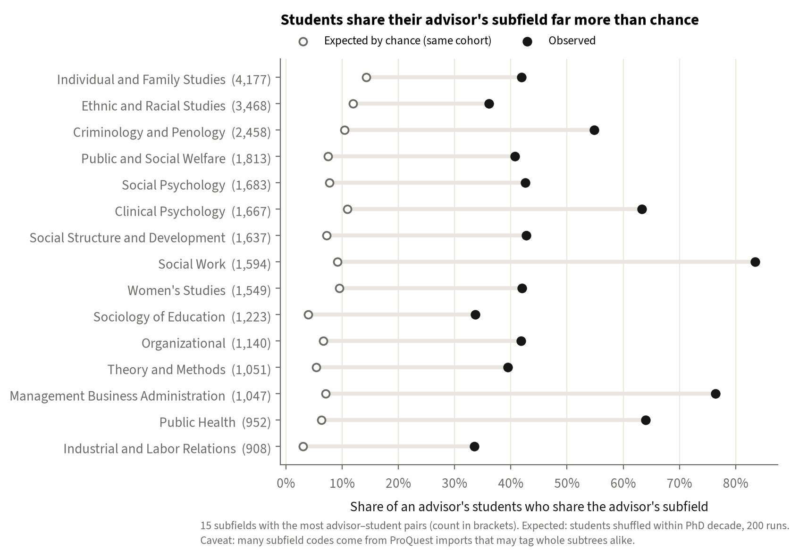
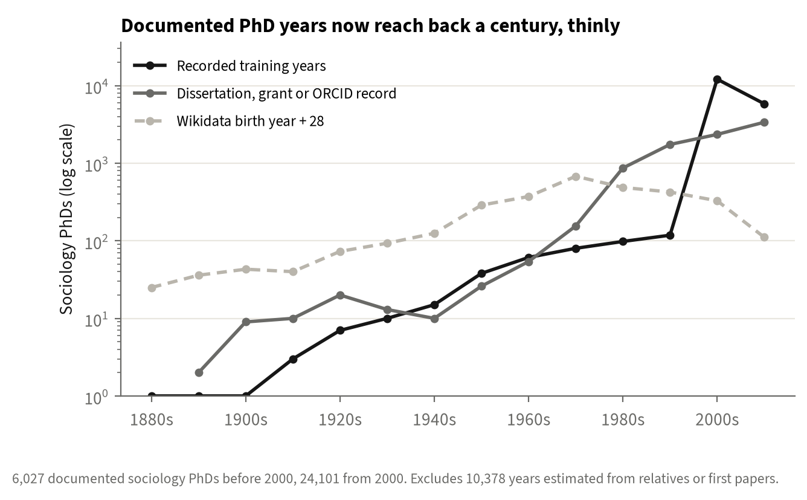
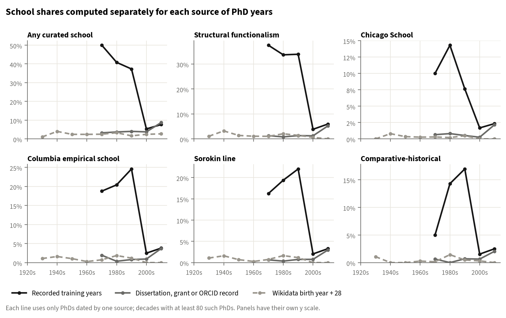
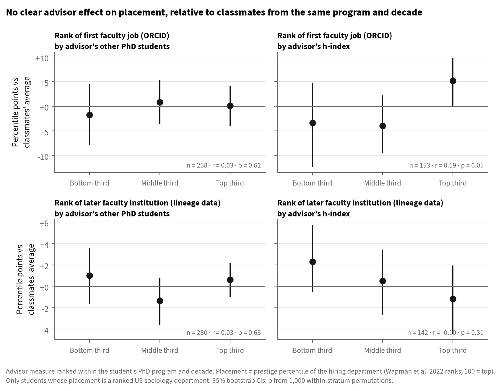

# First-pass analyses: sociology's academic lineages

Generated by `scripts/analysis/run_analyses.py` from the cleaned, merged data (45,597 people; 38,695 PhD advisor links from the Academic Family Tree, NSF dissertation grants, Wikidata, theses.fr and six US dissertation repositories, after merging 97 duplicate records). All numbers are in [`results.json`](results.json). Rerun the script after any re-export.

These are exploratory results. Each section names the main threat to validity; none should be cited before that threat is addressed.

---

## A1. A few programs train most US sociology faculty

**Data:** faculty hiring census, US sociology faculty 2011–20, n = 4,676, by PhD institution (Wapman et al., *Nature* 2022).

- 249 institutions produced faculty. The **top 5 trained 20%**, the **top 10 trained 32%** and the **top 20 trained 50%**. Gini of production = **0.72**.
- The five biggest producers were Wisconsin (227), Berkeley (219), Michigan (164), Chicago (163) and Harvard (151).
- **90% of moves between institutions go down the prestige ranking** and 10% go up, using the census's own ranks. Only 4.5% of faculty work where they trained.

**Caveat:** this is the census's own population (US faculty in departments it classifies as Sociology), so it says nothing about non-US or non-academic careers. Prestige ranks come from the same hiring network, so "90% move down" is partly built in by how the ranking is constructed.

## A2. Students of the most prolific advisors advise a little more, and only them

**Data:** sociology advisor→student PhD pairs where the student finished in 2000–06 (n = 9,056), so every student had at least 16 years before the 2022 snapshot to take on students.

- The raw correlation between an advisor's other students and the student's own students is **ρ = 0.08**. Comparing only within the same PhD year, it is **ρ = 0.08** (permutation p = 0.002).
- The effect is concentrated at the top. Students of advisors with **20+ other students** average **0.20 more students than their cohort** (95% CI 0.08–0.33). The other groups are indistinguishable from their cohort average.

**Caveats:**
- **Outcome sparsity:** most students from this cohort have no recorded students of their own.
- **Recording bias:** prolific advisors' lineages are probably curated more completely in the Academic Family Tree, which would inflate the effect.
- An earlier pooled version over 1900–2000 gave ρ = 0.19, but nearly all of that was cohort timing (dated pre-2000 records were rare in that build).

## A3. Students share their advisor's subfield 3–11× more often than chance

**Data:** 16,412 advisor→student pairs where both people have research-area tags. "Expected" shuffles students among advisors within the same PhD decade (200 permutations).

- Every one of the 15 most common subfields is inherited far above chance:
  - **Criminology:** 55% observed vs 10% expected
  - **Theory and Methods:** 39% vs 5%
  - **Social Work:** 84% vs 9%
  - **Sociology of Education:** 34% vs 4%
- The ratios are largest for applied or professional subfields (Social Work, Public Health, Management, Industrial and Labor Relations; about 9–11×), and smallest for broad ones (Individual and Family Studies, Ethnic and Racial Studies; about 3×).

**Caveat (serious):** many research-area tags are ProQuest subject codes attached when whole subtrees were imported. If an advisor's tags were inferred from their students' dissertations, inheritance is partly circular. A3b repeats the test on publication topics, which don't have this problem.

## A3b. Students publish on their advisor's topics, partly because they publish with them

**Data:** 3,028 advisor→student pairs where both people are matched to OpenAlex. Each person's topics are their 3 most frequent OpenAlex publication topics, computed from their own papers, so they can't be copied down a subtree the way ProQuest codes can. "Expected" shuffles students within PhD decade (200 permutations).

- **50% of pairs share at least one topic, vs 5% expected** (permutation p < 0.005).
- Across the 34 topics with 60+ pairs, the median lift is **11×**. The lift is smallest for broad topics (Contemporary Sociological Theory, 2×; Family Dynamics, 4.5×) and largest for narrow ones (Attachment and Relationship Dynamics, 18×; Aging and Elder Care, 24×).
- **Most of this comes from co-authorship.** Among the 1,142 pairs who never co-authored a paper, **17% share a topic**: still about 3× chance, but far below 50%.

**Caveats:**
- **Selection:** pairs who never co-authored aren't a random subset. They may be weaker ties, or the student may have left research, so 17% is a conservative floor rather than the "true" effect.
- **Coverage:** only matched people with enough papers have topics, which tilts the sample toward research-active, recent cohorts.
- The 3-topic cutoff makes "shared" coarse. Topic-vector similarity would be a better measure.

## A4. School shares over time can't yet be separated from where the years come from

**Data:** sociology PhDs with a *documented* year, n = 30,128:
- recorded training years (AFT-MAG)
- dissertation, grant or ORCID records
- Wikidata birth year + 28

The 10,378 years estimated from relatives or first papers are excluded. Only people with dated relatives can get an estimate from relatives, and those people are linked by definition, so including them would inflate the shares. A person "descends" from a school if a chain of advisor links reaches back to one of its founders in `data/schools.json`.

- **Coverage before 2000 is usable but thin:** 6,027 documented PhDs, against 395 in the previous build. Every decade from the 1920s on has 100 or more.
- **Pooled across sources,** the share descending from any curated school peaks at 10–11% in the 1940s–50s, falls to 5–6% from the 1980s, and rises to 8% in the 2010s. Chicago appears to decline from 5–6% (1920s–40s) to about 1% (1990s), and structural functionalism and Columbia appear to peak in the 1950s.

### A4b. Within each source, that pattern disappears

Here the shares are computed separately for each source of years, counting only decades with at least 80 PhDs from that source.

- **Wikidata birth years (1930s–2010s):** the share descending from any school is flat at 1–4% in every decade. Chicago stays below 1% throughout. Nothing peaks mid-century.
- **Dissertation, grant and ORCID records (1970s on):** flat at 3–4% until the 2010s, when it jumps to 8.7%.
- **Recorded training years (AFT-MAG):** 37–50% of the few hundred pre-2000 PhDs descend from a curated school, against 5–8% after 2000. Pre-2000 recorded years cover mostly the well-curated, famous lineages.

So the pooled curve is mainly the source mix. Each decade's share depends on which source dominates that decade: Wikidata before 1970, French theses in the 1980s–90s, AFT-MAG after 2000. No single source shows Chicago's decline or the mid-century functionalist peak. **The A4 charts should not be read as the history of schools.**

The one pattern that shows up in two sources is the **2010s rise**: recorded years go from 5% to 8%, dissertation records from 4% to 8.7%. Even that may reflect which recent records get linked into the tree, rather than renewed growth.

**What would fix it:** one source that dates PhDs consistently across the century and links advisors, which is what ProQuest provides. Short of that, the honest comparison is within a source, and Wikidata is the only one spanning 1930–2010.

## A5. No clear sign that advisor standing affects placement

**Question:** compare students from the *same PhD program and decade*. Do students of more prolific advisors (more PhD students) or more cited advisors (higher h-index) get faculty jobs in higher-ranked sociology departments? Comparing classmates holds the program's own prestige constant, which placement studies without advisor links can't do.

**Data:**
- Students with a documented PhD year whose program maps to the hiring census (12,877).
- **Outcome 1, first faculty job:** the first professor or lecturer position in ORCID within 6 years of the PhD. 782 students have one, and for 348 it is in a ranked US sociology department.
- **Outcome 2, later faculty institution:** where the person advised students, or else a recorded affiliation (419 ranked).
- Placement is the department's prestige percentile from Wapman et al. (100 = top).
- The advisor measure is ranked within the student's program and decade. The p-values come from 1,000 permutations within those groups.

| Outcome | Advisor measure | n | r | p |
|---|---|---|---|---|
| First faculty job | other PhD students | 258 | 0.03 | 0.61 |
| First faculty job | h-index | 153 | 0.19 | 0.05 |
| Later faculty institution | other PhD students | 280 | 0.03 | 0.66 |
| Later faculty institution | h-index | 142 | −0.10 | 0.31 |
| First job is in a ranked department at all | other PhD students | 685 | 0.02 | 0.64 |

- Four of five tests are null. The one borderline result (p = 0.05) is advisor h-index → first job. Students of the top third by h-index place about 5 percentile points above their classmates. That hit doesn't survive a correction for five tests (Bonferroni threshold 0.01), and the same measure points the other way for later faculty institution.
- **Read this as "no detectable effect", not "no effect".** With about 150–280 students in groups that hold at least two classmates, the test can only detect correlations of roughly 0.15–0.2 or larger.

**Caveats:**
- **ORCID coverage is selective.** Only 20% of the 12,877 students have an ORCID career at all, and 30% of those list a faculty job within six years of the PhD (6% overall). Older cohorts rarely use ORCID.
- **Matching is strict.** ORCID organisation names map to census departments only by exact name. That avoids false matches (George Washington ≠ WashU) but drops some real ones.
- **Institution vs department.** The census ranks sociology departments, while ORCID records the university, so a job in another department of a ranked university counts as a sociology placement.
- **h-index is current, not as of the student's PhD year**, so it partly reflects the advisor's later career.

**What would fix it:** more first-job records. The census's own person-level data, if Wapman et al. would share it under agreement, would multiply the sample.

---

## Data notes
- **People and links:** Academic Family Tree snapshot 2022-03-12 (CC-BY-4.0). Added links:
  - NSF Sociology DDRIGs, 2008+ only (91 confirm existing links, 449 new)
  - Wikidata P184/P185, strict sociologists only (415 confirm, 5,335 new)
  - theses.fr doctoral theses (99 confirm, 10,718 new)
  - DSpace repositories at Minnesota, Illinois, Cornell, Chicago, Oregon and Wisconsin (82 confirm, 594 new)
  - Wikidata doctoral advisors of known people in any field, up to 4 generations up (`scripts/fetch_wikidata_ancestors.py`; about 700 links). Advisors who aren't sociologists on Wikidata are flagged outside the field.
  - Links entered by hand in the explorer's Data gaps tab, saved as `data/manual_edges*.csv` (source "manual")
- **Duplicates:** 97 were merged automatically (`data/external/person_merges.csv`), and 22 uncertain pairs await review (`data/external/duplicate_review.csv`). To add merges by hand, put `drop_pid,keep_pid` rows in `person_merges_manual.csv`.
- **OpenAlex:** 8,269 people are matched to OpenAlex author records (high or medium confidence, by DOI voting); this is what the next analyses build on.
- **Rebuild everything:** `sh scripts/build_all.sh` runs the merge, deduplication, exports and these analyses in order.
- **Schools:** founders are the seed list in `data/schools.json`. Results that depend on schools (A4) change if that list changes.
- **Years:** each person's PhD year carries a basis code (recorded, record, birth, first paper, estimated). Analyses that need years state which bases they use.

## Next analyses
1. **Schools over time within Wikidata only,** with founders reviewed. Wikidata is the one source that spans 1930–2010, though it covers only notable people.
2. **Placement with more first-job data:** ask Wapman et al. for person-level census data, or use OpenAlex affiliation histories as a first-job proxy.
3. **Topic similarity instead of shared top-3 topics** for A3b, with co-authorship modelled rather than dropped.
