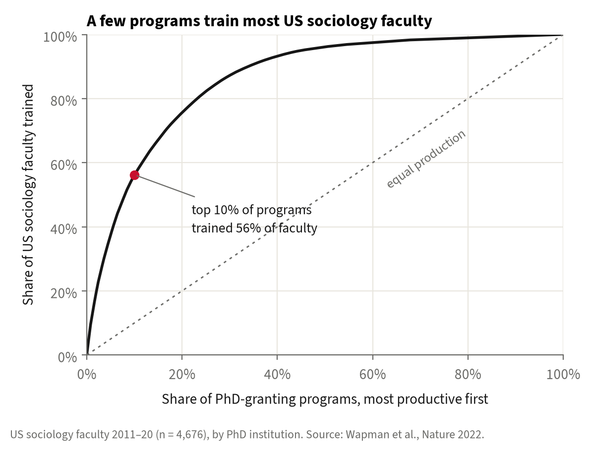
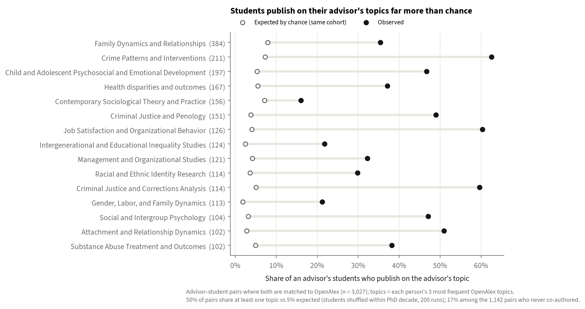
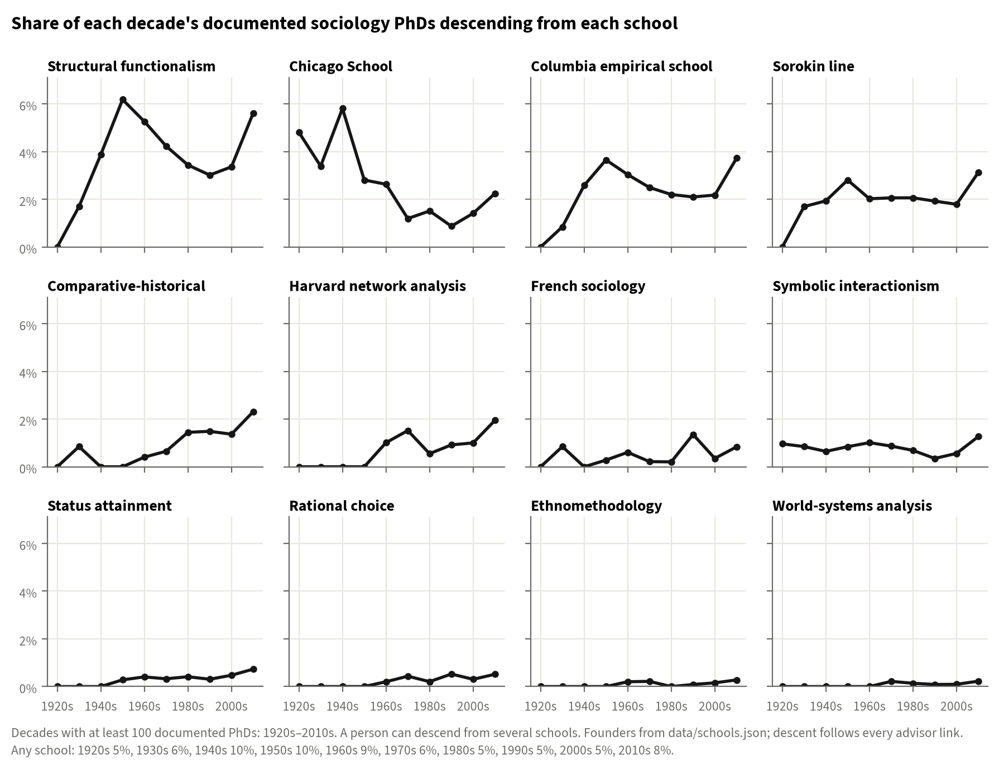

# First-pass analyses: sociology's academic lineages

Generated by `scripts/analysis/run_analyses.py` from the cleaned, merged data (45,080 people; 38,021 PhD advisor links from the Academic Family Tree, NSF dissertation grants, Wikidata, theses.fr and six US dissertation repositories, after merging 97 duplicate records). All numbers are in [`results.json`](results.json). Rerun the script after any re-export.

These are exploratory results. Each section names the main threat to validity; none should be cited before that threat is addressed.

---

## A1. A few programs train most US sociology faculty

**Data:** faculty hiring census, US sociology faculty 2011–20, n = 4,676, by PhD institution (Wapman et al., *Nature* 2022).

- 249 institutions produced faculty. The **top 5 trained 20%**, the **top 10 trained 32%** and the **top 20 trained 50%**. Gini of production = **0.72**.
- The five biggest producers were Wisconsin (227), Berkeley (219), Michigan (164), Chicago (163) and Harvard (151).
- **90% of moves between institutions go down the prestige ranking** and 10% go up, using the census's own ranks. Only 4.5% of faculty work where they trained.

**Caveat:** this is the census's own population (US faculty in departments it classifies as Sociology), so it says nothing about non-US or non-academic careers. Prestige ranks come from the same hiring network, so "90% move down" is partly built in by how the ranking is constructed.

## A2. Students of the most prolific advisors advise a little more, and only them

**Data:** sociology advisor→student PhD pairs where the student finished in 2000–06 (n = 9,056), so every student had at least 16 years before the 2022 snapshot to take on students.

- The raw correlation between an advisor's other students and the student's own students is **ρ = 0.08**. Comparing only within the same PhD year, it is **ρ = 0.08** (permutation p = 0.002).
- The effect is concentrated at the top. Students of advisors with **20+ other students** average **0.20 more students than their cohort** (95% CI 0.09–0.34). The other groups are indistinguishable from their cohort average.

**Caveats:**
- **Outcome sparsity:** most students from this cohort have no recorded students of their own.
- **Recording bias:** prolific advisors' lineages are probably curated more completely in the Academic Family Tree, which would inflate the effect.
- An earlier pooled version over 1900–2000 gave ρ = 0.19, but nearly all of that was cohort timing (dated pre-2000 records were rare in that build).

## A3. Students share their advisor's subfield 3–11× more often than chance

**Data:** 16,412 advisor→student pairs where both people have research-area tags. "Expected" shuffles students among advisors within the same PhD decade (200 permutations).

- Every one of the 15 most common subfields is inherited far above chance:
  - **Criminology:** 55% observed vs 10% expected
  - **Theory and Methods:** 39% vs 5%
  - **Social Work:** 84% vs 9%
  - **Sociology of Education:** 34% vs 4%
- The ratios are largest for applied or professional subfields (Social Work, Public Health, Management, Industrial and Labor Relations; about 9–11×), and smallest for broad ones (Individual and Family Studies, Ethnic and Racial Studies; about 3×).

**Caveat (serious):** many research-area tags are ProQuest subject codes attached when whole subtrees were imported. If an advisor's tags were inferred from their students' dissertations, inheritance is partly circular. A3b repeats the test on publication topics, which don't have this problem.

## A3b. Students publish on their advisor's topics, partly because they publish with them

**Data:** 3,027 advisor→student pairs where both people are matched to OpenAlex. Each person's topics are their 3 most frequent OpenAlex publication topics, computed from their own papers, so they can't be copied down a subtree the way ProQuest codes can. "Expected" shuffles students within PhD decade (200 permutations).

- **50% of pairs share at least one topic, vs 5% expected** (permutation p < 0.005).
- Across the 34 topics with 60+ pairs, the median lift is **11×**. The lift is smallest for broad topics (Contemporary Sociological Theory, 2×; Family Dynamics, 4.5×) and largest for narrow ones (Attachment and Relationship Dynamics, 18×; Aging and Elder Care, 24×).
- **Most of this comes from co-authorship.** Among the 1,142 pairs who never co-authored a paper, **17% share a topic**: still about 3× chance, but far below 50%.

**Caveats:**
- **Selection:** pairs who never co-authored aren't a random subset. They may be weaker ties, or the student may have left research, so 17% is a conservative floor rather than the "true" effect.
- **Coverage:** only matched people with enough papers have topics, which tilts the sample toward research-active, recent cohorts.
- The 3-topic cutoff makes "shared" coarse. Topic-vector similarity would be a better measure.

## A4. Classic schools: a mid-century peak, then a steady small share

**Data:** sociology PhDs with a *documented* year, n = 30,166:
- recorded training years (AFT-MAG)
- dissertation, grant or ORCID records
- Wikidata birth year + 28

The 10,382 years estimated from relatives or first papers are excluded. Only people with dated relatives can get an estimate from relatives, and those people are linked by definition, so including them would inflate the shares. A person "descends" from a school if a chain of advisor links reaches back to one of its founders in `data/schools.json`.

- **Coverage before 2000 is now usable but thin:** 6,065 documented PhDs, against 395 in the previous build. Every decade from the 1920s on has 100 or more. Before 1970 most come from Wikidata birth years. In the 1980s–90s most come from dissertation records, mainly theses.fr. Since 2000 most are AFT-MAG recorded years.
- **The share descending from any curated school** peaks at **10% in the 1940s–50s**, falls to **5% by the 1980s** and stays there through the 2000s, then rises to 8% in the 2010s.
- **Chicago is the earliest and declines longest:** 5–6% of PhDs in the 1920s–40s, about 1% by the 1990s. **Structural functionalism** rises from nothing in the 1920s to a **6% peak in the 1950s**. **Columbia** peaks at 4% in the 1950s. Both then slide to about 3% and 2%.
- The newer lines (comparative-historical, Harvard networks, status attainment) start near zero and grow to 1–2%.

**Caveats:**
- **Source mix changes by decade.** Wikidata dates notable people, who sit disproportionately in famous lineages, so pre-1970 shares are probably too high. The 1980s–90s are dominated by French theses, which rarely link to US schools, so those shares are probably too low. Part of the peak-and-decline could be this mix rather than history.
- **The 2010s uptick** coincides with the AFT's own recent curation, which follows the lineages users care about.
- **School definitions are a seed list.** Shares depend on which founders are named, and descendants of several schools count for each.

---

## Data notes
- **People and links:** Academic Family Tree snapshot 2022-03-12 (CC-BY-4.0). Added links:
  - NSF Sociology DDRIGs, 2008+ only (91 confirm existing links, 449 new)
  - Wikidata P184/P185, strict sociologists only (415 confirm, 5,335 new)
  - theses.fr doctoral theses (99 confirm, 10,718 new)
  - DSpace repositories at Minnesota, Illinois, Cornell, Chicago, Oregon and Wisconsin (82 confirm, 594 new)
- **Duplicates:** 97 were merged automatically (`data/external/person_merges.csv`), and 22 uncertain pairs await review (`data/external/duplicate_review.csv`). To add merges by hand, put `drop_pid,keep_pid` rows in `person_merges_manual.csv`.
- **OpenAlex:** 8,269 people are matched to OpenAlex author records (high or medium confidence, by DOI voting); this is what the next analyses build on.
- **Rebuild everything:** `sh scripts/build_all.sh` runs the merge, deduplication, exports and these analyses in order.
- **Schools:** founders are the seed list in `data/schools.json`. Results that depend on schools (A4) change if that list changes.
- **Years:** each person's PhD year carries a basis code (recorded, record, birth, first paper, estimated). Analyses that need years state which bases they use.

## Next analyses
1. **Advisor prestige → student placement:** join ORCID employment (now 7,434 careers) to the hiring census ranks.
2. **Topic similarity instead of shared top-3 topics** for A3b, with co-authorship modelled rather than dropped.
3. **A4 by source:** recompute school shares within one source at a time (for example only recorded years, or only US repositories) to separate history from source mix. ProQuest advisor data would remove most of this problem.
