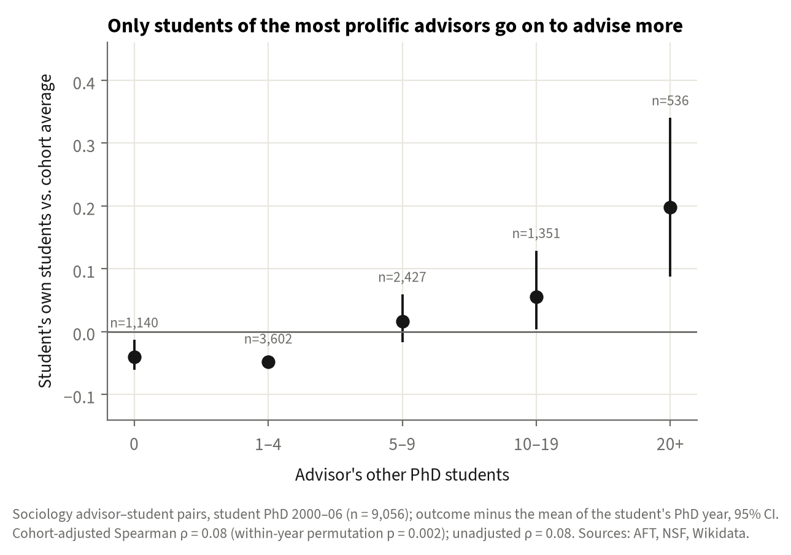

# First-pass analyses: sociology's academic lineages

Generated by `scripts/analysis/run_analyses.py` from the cleaned, merged data (34,054 people; 26,709 PhD advisor links from the Academic Family Tree, NSF dissertation grants and Wikidata, after merging 96 duplicate records). All numbers are in [`results.json`](results.json). Rerun the script after any re-export.

These are exploratory results. Each section names the main threat to validity; none should be cited before that threat is addressed.

---

## A1. A few programs train most US sociology faculty

**Data:** faculty hiring census, US sociology faculty 2011–20, n = 4,676, by PhD institution (Wapman et al., *Nature* 2022).

- 249 institutions produced faculty. The **top 5 trained 20%**, the **top 10 trained 32%** and the **top 20 trained 50%**. Gini of production = **0.72**.
- The five biggest producers were Wisconsin (227), Berkeley (219), Michigan (164), Chicago (163) and Harvard (151).
- **90% of moves between institutions go down the prestige ranking** and 10% go up, using the census's own ranks. Only 4.5% of faculty work where they trained.

**Caveat:** this is the census's own population (US faculty in departments it classifies as Sociology), so it says nothing about non-US or non-academic careers. Prestige ranks come from the same hiring network, so "90% move down" is partly built in by how the ranking is constructed.

## A2. Students of the most prolific advisors advise a little more, and only them

**Data:** sociology advisor→student PhD pairs where the student finished in 2000–06 (n = 9,045), so every student had at least 16 years before the 2022 snapshot to take on students.

- The raw correlation between an advisor's other students and the student's own students is **ρ = 0.07**. Comparing only within the same PhD year, it is **ρ = 0.07** (permutation p = 0.002).
- The effect is concentrated at the top. Students of advisors with **20+ other students** average **0.17 more students than their cohort** (95% CI 0.07–0.29). The other groups are indistinguishable from their cohort average.

**Caveats:**
- **Outcome sparsity:** most students from this cohort have no recorded students of their own.
- **Recording bias:** prolific advisors' lineages are probably curated more completely in the Academic Family Tree, which would inflate the effect.
- An earlier pooled version over 1900–2000 gave ρ = 0.19, but nearly all of that was cohort timing (dated pre-2000 records are rare; see A4).

## A3. Students share their advisor's subfield 3–11× more often than chance

**Data:** 16,404 advisor→student pairs where both people have research-area tags. "Expected" shuffles students among advisors within the same PhD decade (200 permutations).

- Every one of the 15 most common subfields is inherited far above chance:
  - **Criminology:** 55% observed vs 10% expected
  - **Theory and Methods:** 40% vs 5%
  - **Social Work:** 84% vs 9%
  - **Sociology of Education:** 34% vs 4%
- The ratios are largest for applied or professional subfields (Social Work, Public Health, Management, Industrial and Labor Relations; about 9–11×), and smallest for broad ones (Individual and Family Studies, Ethnic and Racial Studies; about 3×).

**Caveat (serious):** many research-area tags are ProQuest subject codes attached when whole subtrees were imported. If an advisor's tags were inferred from their students' dissertations, inheritance is partly circular. To fix it, re-estimate using only advisors whose tags come from their own record, or use OpenAlex publication topics once matching finishes.

## A4. School histories can't be traced yet: PhD years exist almost only for 2000–14

- Training years (from the AFT-MAG mentorship file) cover **17,763 sociology PhDs in 2000–14** but only **395 before 2000**.
- Of the 2000–14 PhDs, just **6% descend from one of the 12 curated schools**. Most recent dissertation records are not linked to the classic lineages at all.

So "the rise and fall of schools" cannot be read off the current data: any pre-2000 trend rests on a few hundred people, and after 2000 the share is driven by which records happen to be linked.

**What fixes it:** dated pre-2000 PhDs with advisors. ProQuest Dissertations has these, and dissertation repositories (harvest in progress) add some.

---

## Data notes
- **People and links:** Academic Family Tree snapshot 2022-03-12 (CC-BY-4.0). Added links:
  - NSF Sociology DDRIGs, 2008+ only (91 confirm existing links, 449 new)
  - Wikidata P184/P185, strict sociologists only (415 confirm, 5,335 new)
- **Duplicates:** 96 were merged automatically (`data/external/person_merges.csv`), and 22 uncertain pairs await review (`data/external/duplicate_review.csv`). To add merges by hand, put `drop_pid,keep_pid` rows in `person_merges_manual.csv`.
- **OpenAlex:** 8,252 people are matched to OpenAlex author records (high or medium confidence, by DOI voting); this is what the next analyses build on.
- **Rebuild everything:** `sh scripts/build_all.sh` runs the merge, deduplication, exports and these analyses in order.
- **Schools:** founders are the seed list in `data/schools.json`. Results that depend on schools (A4) change if that list changes.

## Next analyses, once the data allows
1. **Advisor prestige → student placement:** join OpenAlex matches and ORCID employment to the hiring census ranks.
2. **Subfield inheritance on publication topics:** removes the ProQuest circularity in A3.
3. **School share over time:** needs pre-2000 dated PhDs (ProQuest, repositories).
