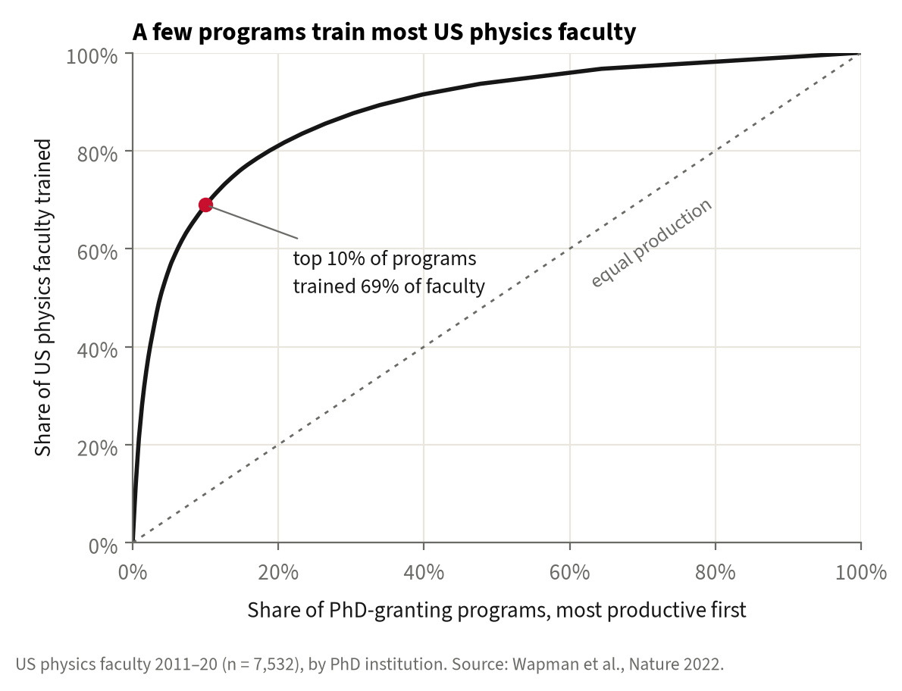
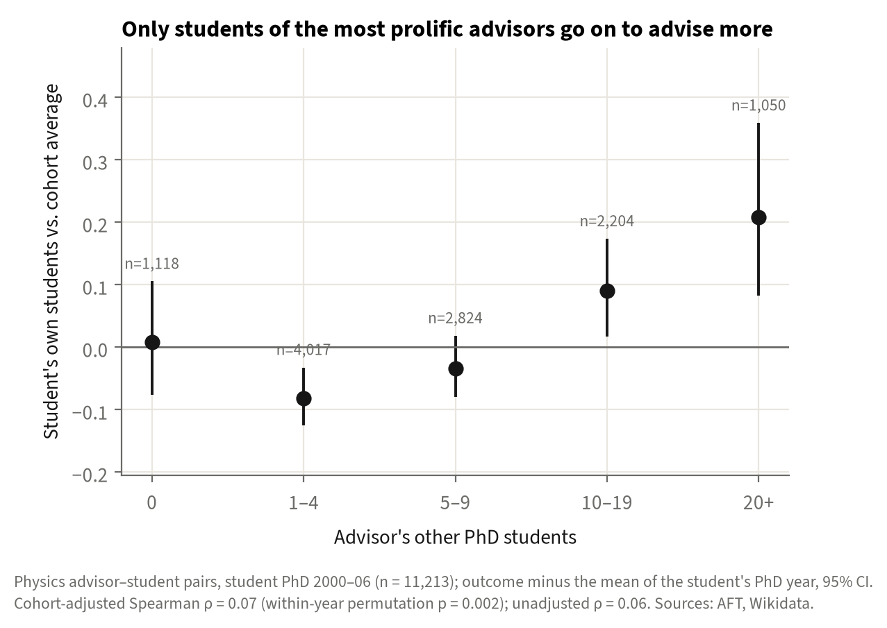
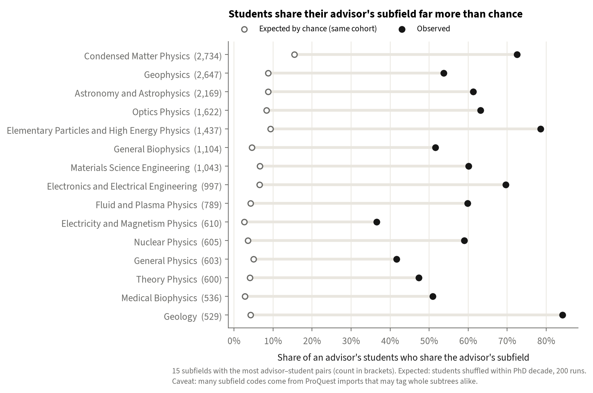
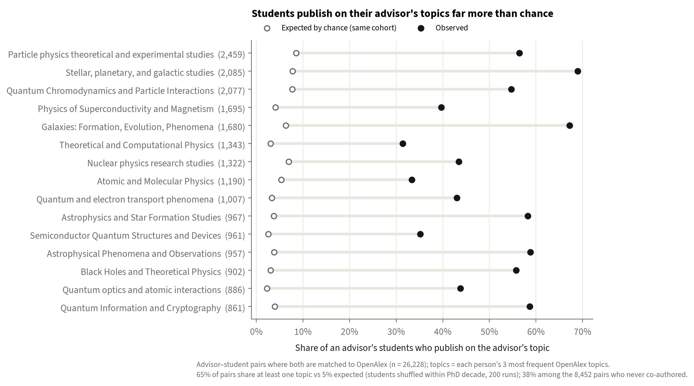
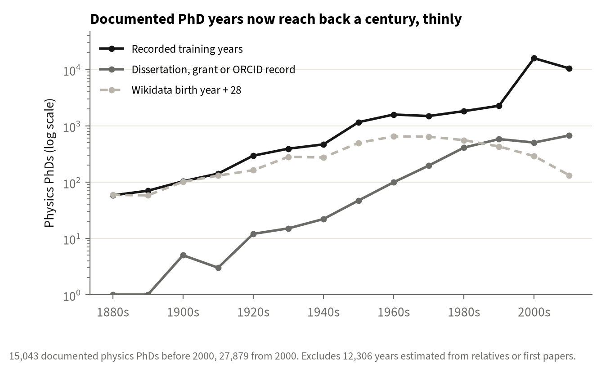
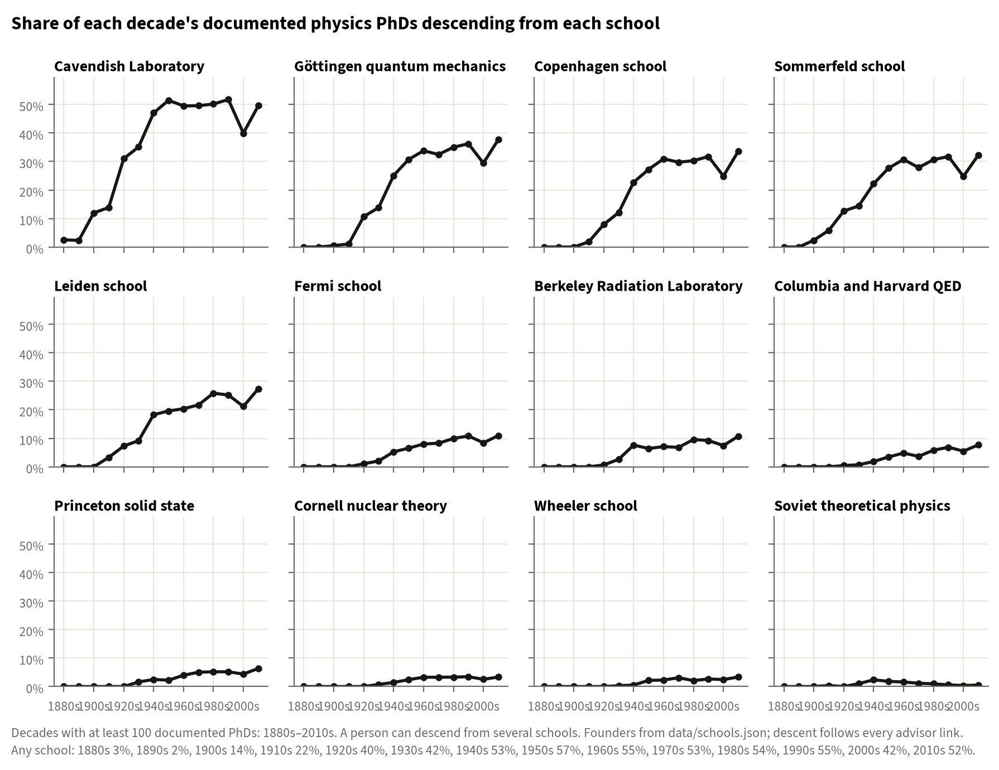
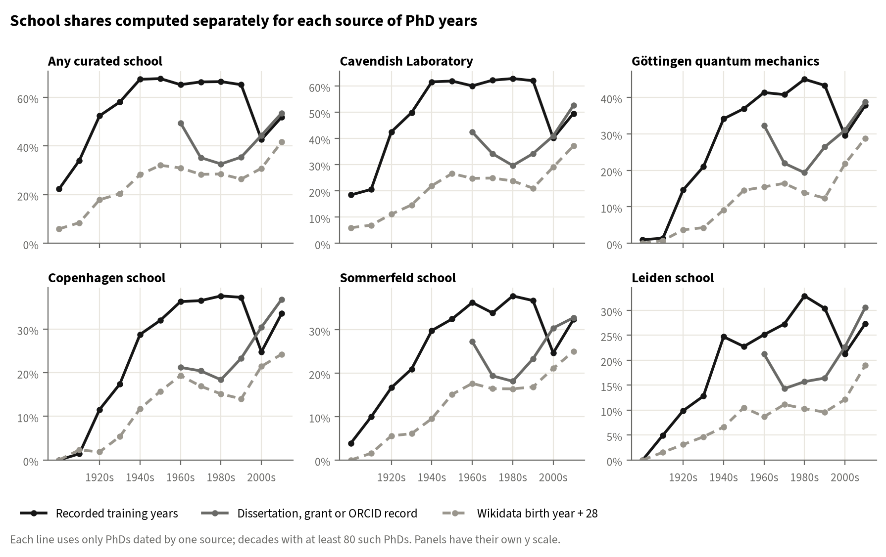
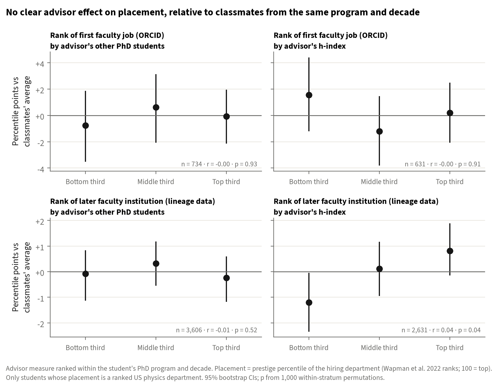

# First-pass analyses: physics' academic lineages

Generated by `LINEAGE_FIELD=physics .venv/bin/python scripts/analysis/run_analyses.py` from the cleaned, merged physics data: 82,323 people and 72,711 PhD advisor links from the Academic Family Tree and Wikidata, after merging 529 duplicate records. All numbers are in [`results.json`](results.json). The sociology write-up is in [`../README.md`](../README.md); the methods are the same, so this file gives the physics numbers and notes where physics differs.

These are exploratory results. Each section names the main threat to validity; none should be cited before that threat is addressed.

---

## A1. A few programs train most US physics faculty

**Data:** faculty hiring census, US physics faculty 2011–20, n = 7,532, by PhD institution (Wapman et al., *Nature* 2022).

- 696 institutions produced faculty. The **top 5 trained 18%**, the **top 10 trained 30%** and the **top 20 trained 44%**. Gini of production = **0.76**.
- The five biggest producers were Berkeley (317), Harvard (295), MIT (288), Princeton (247) and Stanford (234).
- **89% of moves between institutions go down the prestige ranking** and 11% go up. 6.2% of faculty work where they trained.

**Caveat:** the census's own population (US faculty in departments it classifies as Physics). Prestige ranks come from the same hiring network, so "89% move down" is partly built in by how the ranking is constructed.

## A2. Students of the most prolific advisors advise more

**Data:** physics advisor→student PhD pairs where the student finished in 2000–06 (n = 11,213).

- Raw ρ = **0.06**; within the same PhD year ρ = **0.07** (permutation p = 0.002).
- Students of advisors with **20+ other students** average **0.21 more students than their cohort** (95% CI 0.08–0.36), and those with 10–19 average 0.09 more (0.02–0.17). Students of advisors with 1–4 others average 0.08 *fewer* (−0.13 to −0.03).

**Caveats:** most students in this cohort have no recorded students, and prolific advisors' lineages are probably curated more completely, which would inflate the effect. Same as sociology.

## A3. Students share their advisor's subfield 5–20× more often than chance

**Data:** 17,943 advisor→student pairs where both have research-area tags; expected shuffles students within PhD decade.

- All 15 most common subfields are inherited far above chance. The lift is smallest for the biggest areas (Condensed Matter, 72% observed vs 15% expected, 4.7×; Geophysics 6.1×; Astronomy 7.0×) and largest for small, self-contained ones (Nuclear Physics 17×, Medical Biophysics 18×, Geology 20×).

**Caveat (serious):** as in sociology, many tags are ProQuest subject codes attached to whole imported subtrees, so this is partly circular. A3b avoids that.

## A3b. Students publish on their advisor's topics, mostly but not only through joint papers

**Data:** 26,228 advisor→student pairs where both are matched to OpenAlex; each person's 3 most frequent publication topics.

- **65% of pairs share at least one topic, vs 5% expected** (permutation p < 0.005).
- Among the 8,452 pairs who never co-authored, **38% share a topic**, about 8× chance. In sociology the same figure is 17%, so physics students stay closer to their advisor's topics even when they don't publish with them.
- Lifts are lowest for broad topics (Quantum and Classical Electrodynamics, 6×) and very high for narrow ones (geomagnetism, satellite control: over 150×, because almost no one else holds those topics).

**Caveats:** pairs who never co-authored are a selected group; topic coverage tilts toward recent, research-active people; the 3-topic cutoff is coarse.

## A4. School shares rise to mid-century and then plateau, in every source

**Data:** physics PhDs with a documented year, n = 42,922 (15,043 before 2000). The 12,306 years estimated from relatives or first papers are excluded. Founders are in [`fields/physics/data/schools.json`](../../../fields/physics/data/schools.json).

- Pooled across sources, the share descending from any of the 12 seed schools climbs from 2% in the 1880s to **57% in the 1950s**, holds at 53–55% through the 1990s, and is 42–52% after 2000.
- The **Cavendish** (J. J. Thomson and Rutherford) dominates: about half of all documented PhDs from the 1950s on descend from it. Göttingen, Copenhagen and Sommerfeld each reach 30–36%. Schools overlap heavily, since one person can descend from Rutherford, Bohr and Born at once.
- **Soviet theoretical physics** (Landau, Tamm) never exceeds 2.4%. That says more about the Academic Family Tree's thin coverage of Soviet records than about the school.

### A4b. Unlike sociology, the shape survives splitting by source

- **Wikidata birth years:** 6% in the 1900s, rising to **32% in the 1950s**, flat at 26–31% through the 2000s, then 42% in the 2010s.
- **Recorded training years:** 22% in the 1900s, rising to 67% by the 1940s, flat at 65–68% to the 1990s.
- **Dissertation, grant and ORCID records (1960s on):** 33–49%, rising to 54% in the 2010s.

The levels differ by source (recorded years favour well-curated lineages, Wikidata favours notable people), but all three show the same rise through the 1940s–50s and a plateau after. In sociology the pooled pattern disappeared within sources; in physics it doesn't.

**Caveat:** a rise-then-plateau is partly mechanical. Founders who worked around 1900 need a few generations before their descendants make up a large share of anyone, and the seed list picks schools already known to have succeeded. The plateau, not the rise, is the more interesting result: from the 1950s on, roughly a third to two thirds of physicists (depending on source) trace back to a dozen early-20th-century founders.

## A5. No detectable advisor effect on placement

**Data:** 24,640 students with a documented PhD year whose program maps to the hiring census. 1,731 have an ORCID faculty job within 6 years of the PhD, 866 in a ranked US physics department; 3,913 have a ranked later faculty institution. Same design as sociology: classmates from the same program and decade, 1,000 within-group permutations.

| Outcome | Advisor measure | n | r | p |
|---|---|---|---|---|
| First faculty job | other PhD students | 734 | −0.00 | 0.93 |
| First faculty job | h-index | 631 | −0.00 | 0.91 |
| Later faculty institution | other PhD students | 3,606 | −0.01 | 0.52 |
| Later faculty institution | h-index | 2,631 | 0.04 | 0.045 |
| First job is in a ranked department at all | other PhD students | 1,574 | −0.01 | 0.83 |

- Four of five tests are null. The borderline one (advisor h-index → later institution, r = 0.04, p = 0.045) doesn't survive a correction for five tests (threshold 0.01), and its size is about one percentile point.
- The samples are two to twenty times larger than sociology's, so the nulls here are tighter: the later-institution tests could detect correlations of roughly 0.05, the first-job tests roughly 0.1.

**Caveats:** ORCID coverage is selective and recent; organisation names match census departments only exactly; the census ranks departments while ORCID records universities; h-index is current, not as of the student's PhD.

---

## Data notes
- **People and links:** Academic Family Tree snapshot 2022-03-12 (CC-BY-4.0), people tagged physics plus anyone who advised or trained one. Added links:
  - Wikidata P184/P185, strict physicists (occupation physicist or field physics): 4,458 confirm existing links, 20,153 new
  - Wikidata doctoral advisors of known roots, up to 4 generations up: 81 links
  - None of sociology's other sources (NSF DDRIGs, theses.fr, university repositories) are physics-specific, so physics has only these two.
- **Postdoc and research ties:** 9,074 links are postdoc, research-scientist or undergraduate-research ties rather than PhD direction. The explorer shows them as mentors and they don't count toward formal descendants.
- **Loops:** 4 advisor loops in the source data (for example Townes ↔ Zeiger, both postdoc ties) were broken by dropping the weaker link; they're listed in `lineage.json` under `meta.cycle_breaks`.
- **Duplicates:** 529 merged automatically; 156 uncertain pairs in `fields/physics/data/external/duplicate_review.csv`.
- **OpenAlex:** 36,225 people matched (high or medium confidence). To stay within the daily API budget, matching used up to 6 DOIs per person (sociology uses 60) and ran without the ORCID tie-break, so match quality is somewhat lower than sociology's. About 4,000 DOIs were left unfetched.
- **Rebuild:** `LINEAGE_FIELD=physics sh scripts/build_field.sh` (add `--fetch` to pull every source again).

## Next analyses
1. **Review the school founders.** The seed list is textbook groupings; adding Soviet and Asian lineages needs sources beyond the AFT.
2. **Finish the OpenAlex fetch** and rerun the vote with the ORCID tie-break.
3. **Compare fields directly:** the same tests run on sociology and physics side by side, especially A3b's non-co-author share and A4b.
